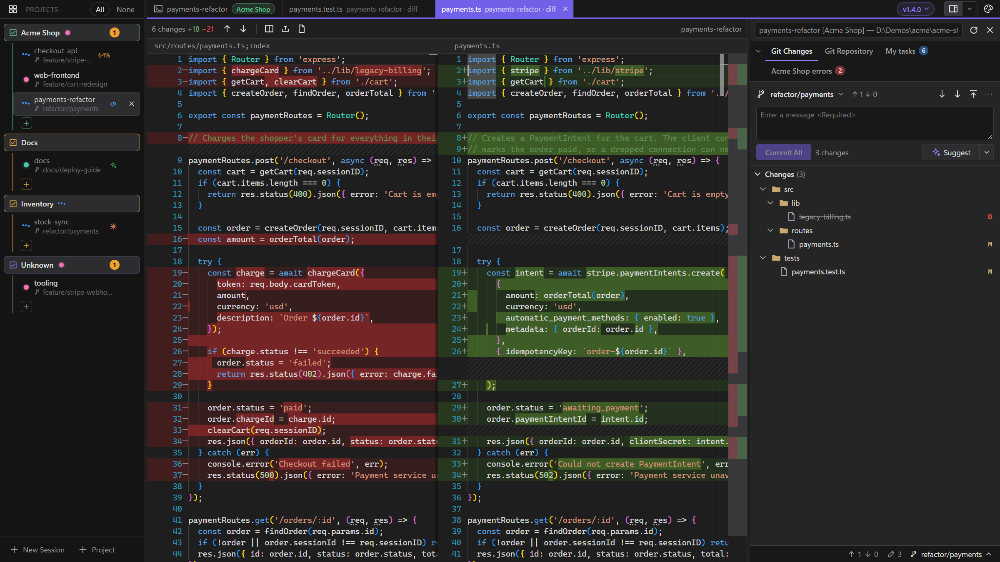
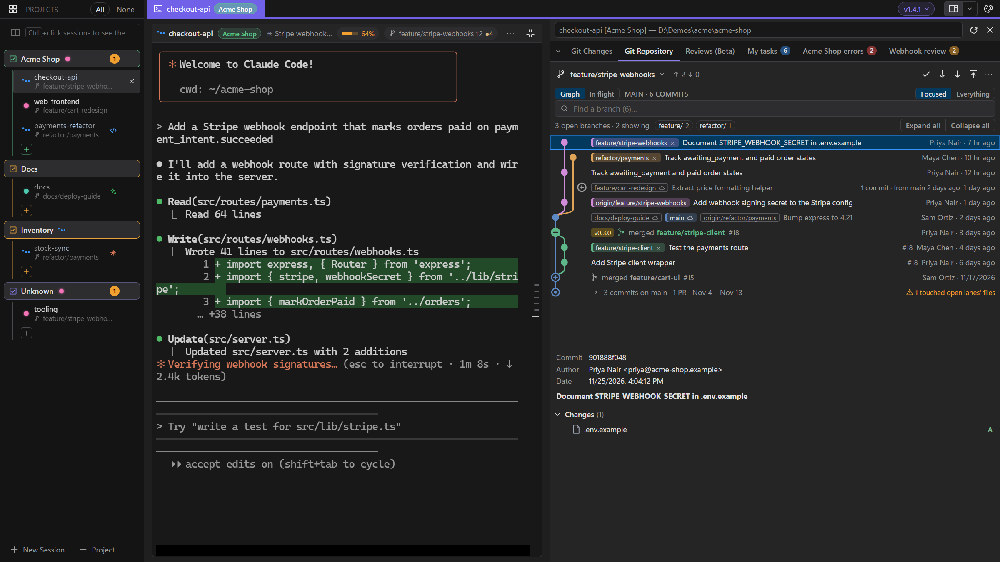
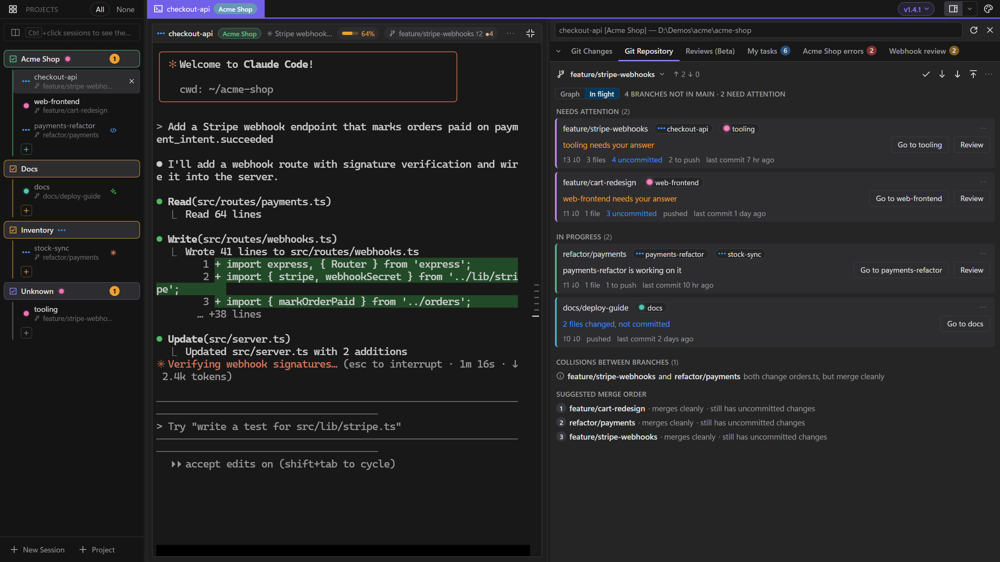

# Git and diffs

The side panel shows the selected session's repository, laid out like Visual Studio: Git Changes for what's in the working tree, Git Repository for history. Diffs open in tabs beside the terminal and refresh as the agent edits.

## Git Changes

- **Staged and unstaged trees,** with stage and unstage on each file or folder.
- **Commit** what's staged, or everything when nothing is.
- **Undo Changes**, as in Visual Studio (right-click a file or folder, or the ↶ on a section header): new files go to the Recycle Bin (the Trash on macOS and Linux). It refuses rather than guesses if the files changed after you confirmed, or if restoring would overwrite a file that now exists at a deleted or renamed file's old name.
- Right-click a folder for **Open in File Explorer** (your file manager on macOS and Linux).

## Diffs

Click any file, in Git Changes or in a commit in Git Repository, for a side-by-side diff (Monaco, with Visual Studio-style colours). A single click opens a reusable preview tab (in italics); double-click keeps it open. Open diffs refresh as the session edits the file. <kbd>Alt</kbd>+<kbd>↑</kbd>/<kbd>↓</kbd> jumps between changes.

- **Tabs belong to their session's project:** switching to a session in another project shows that project's tabs, and yours come back when you return.
- **Closing:** <kbd>Ctrl</kbd>+<kbd>W</kbd> or <kbd>Ctrl</kbd>+<kbd>F4</kbd>, middle-click, or the tab's ×. In the terminal, <kbd>Ctrl</kbd>+<kbd>W</kbd> stays Claude's delete-word.
- **Back to the terminal:** click the Terminal tab, <kbd>Shift</kbd>+<kbd>Esc</kbd> from a diff, or <kbd>Ctrl</kbd>+<kbd>PgUp</kbd> / <kbd>Ctrl</kbd>+<kbd>PgDn</kbd>.

Drag a diff tab towards an edge of the terminal area to show it beside the terminal, so you can watch the agent's output and its changes at once. See [Sessions](sessions.md) for more on putting a tab beside the terminal.

## Suggest

**Suggest**, beside Commit, writes the commit message for what Commit would take (the staged changes, or all of them), in the style of the repository's recent commits. <kbd>Ctrl</kbd>+<kbd>Z</kbd> brings back what was in the box. The ▾ beside it sets how much it writes, remembered for next time:

- *Short*: one line;
- *Standard*: a line, plus a few brief points when a change covers several things;
- *Detailed*: a line and a paragraph on what changed and why.

It runs the session's own agent headless with your own sign-in, sending it the diff, so it uses a little of that agent's plan: Claude Code as `claude -p` (Haiku, no tools, not saved as a conversation), Codex as `codex exec` (read-only, low reasoning, not saved), Antigravity as `agy -p` and Grok as `grok -p` (with no tools; both keep each run as a conversation of their own, run in a folder of LlamaTree's own so no session takes it up). A session running anything else, or whose agent isn't installed, uses the first of these that is: Claude Code, then Codex, then Antigravity, then Grok. The button's tooltip names who will write it.

## Fetch, pull and push

They sit on the Git panel's toolbar, next to the branch and its outgoing and incoming counts.

- **Pull only fast-forwards.** It never creates a merge commit or leaves conflicts in a worktree an agent may be editing, and stops with git's explanation if the branch has diverged.
- **Push never forces.** A branch with no upstream is published to `origin` and tracked.
- Each runs for up to five minutes, long enough to sign in through Git Credential Manager.

## Branches

Click the branch name on the Git toolbar, or in Git Changes' status bar, for the **branch picker**: filter as you type, with *Locals* and *Remotes* tabs. Picking a remote branch switches to its local branch, creating one that tracks it if needed.

- **New Branch** (in the picker, the ⋯ menu, or a commit's right-click menu in Git Repository) takes a name and what to base it on, a branch or a commit, and can switch to it.
- **Switching with uncommitted changes** asks first: bring the changes with you, or stash them and continue. If the switch fails, the stash is put back.
- **The status bar** under Git Changes shows the outgoing and incoming counts (click for Git Repository), the number of changed files and the branch.

## Deleting a branch

Any local branch can be deleted, merged or not: from the bin on its row in the branch picker (or its right-click menu), a branch card's ⋯ menu in In flight, a branch badge's right-click menu in the graph, **Delete…** in an open branch's summary, or a merged branch's ⋯ menu under Reviews' *Done*.

- **It says what goes with it first.** A merged branch loses nothing. For one that isn't merged, the dialog counts the commits that would be lost: those neither main nor the branch's copy on the remote has.
- **Also delete its remote copy.** When the branch is on the remote (its upstream, or the same name on `origin`), a box offers to delete that too, and remembers your choice. If the remote can't be reached, the local branch is still deleted and the message says why the remote one wasn't.
- **Not while it's checked out.** A branch checked out in a worktree can't be deleted; the dialog names the worktree, so you can switch it to another branch first.
- **main can go too**, after a stronger warning: In flight, Reviews and the graph compare every branch with it.
- **A branch only on the remote** (In flight's *On the remote only*, or the picker's *Remotes* tab) can be deleted there, after a confirm. It goes for everyone who uses that remote.

## Repositories that can run programs

A repository's own settings (its `.git/config`, a file that config includes, a submodule's config, its hooks) can tell git to run a program: a filter, an ssh command, a credential helper, a hook. LlamaTree runs git by itself, on start and every few seconds, so a folder you copied or unpacked could otherwise run something you never looked at. Your own global and system git settings always apply as usual.

When a repository has settings like these, Git Changes asks above the file list: *This repository's own settings can run programs: filter.lfs.clean, hook pre-commit. Trust it?* Hover over the question to see each setting and its value.

- **Trust** lets them apply again, in every worktree of that repository. LlamaTree remembers it.
- **Not now** keeps them off. LlamaTree turns off the repository's filters for its own git calls (Git LFS files may then show as changed), and won't fetch, pull, push, commit, stage, undo, switch branches or add a worktree there. If you ask for one of those, the question shows again.
- If the settings change (one is added, or a value or hook changes), you're asked again.
- To take trust back, open the ⋯ menu on the Git toolbar › *Stop Trusting This Repository's Settings*.

Repositories without such settings, such as a plain clone, never ask.

## Git Repository

The history as a commit graph, with each commit's files. Click a file for that commit's diff.

**Graph** and **In flight**, at the top, switch between the history and the branches still to land (remembered). In the graph, the switch above the list chooses what it shows (remembered too):

- **Focused** (the default): the repository's main branch (*main*, *master* or whatever `origin/HEAD` points at), its own line, one row per merge, with branch and tag badges where they point. A tag or branch on commits folded away shows on the fold's row. A merge whose dot shows **+** opens the branch it brought in as a line beside main (**−** hides it again). Each branch not merged yet has one row among main's commits, at the date of its newest commit, with how many commits it has and where it started; click its **+** to open it as a line down to where it forked, growing from where the row was. A branch older than the commits shown appears once you show older ones. The chips above the graph (*feature/*, *fix/*, *dependabot/*…) hide or show the branches with that prefix. Any branch opens by name in **Find a branch**. **Expand all** opens every branch listed; **Collapse all** hides them all.

Point at a line in the graph, or a branch's badge, to follow that branch: its line and commits stay, main stays faintly, and the rest fade. A **+** that opens a branch doesn't, and nor does a branch you've just opened until you point somewhere else. Once a branch is open, the stretches of main in between fold into one row each; click one to unfold it. The current branch starts open. Without a main or master branch, this is the current branch's history instead.
- **Everything**: every local and remote branch and tag, newest first. Each branch has its own coloured line from where it forks off to where it's merged. A merge is a small dot where two lines meet.

Branch and tag badges sit on the commit they point at, edged in the colour of their line. A branch that matches its remote branch shows one badge with a cloud. Outgoing commits, not pushed yet, have hollow dots, and their count shows beside the heading.

## In flight

**In flight**, beside Graph in Git Repository, shows every branch not in main yet, from every worktree, with what each one needs next.

Each branch is a card: its sessions (click one to go to it), what it needs next and the button that does it, commits ahead of and behind main, files changed, and whether it's pushed, reviewed or has a pull request. Click the name to open it in the graph; its ⋯ menu has the rest (Review, Push, the pull request, Copy branch name, Delete). The cards are grouped:

- **Needs attention**: a session waiting for your answer, or a branch that conflicts with main.
- **In progress**: a session is working on it, or it has changes not committed yet.
- **Not pushed**: commits only on this computer (**Push**).
- **Ready for review**: pushed and up to date; **Review** opens its [review](#review), and once approved, its pull request.
- **Stale**: no commits for three weeks, and no session on it.
- **On the remote only**: a branch nobody has here.

Below the cards:

- **Collisions between branches**: pairs that change the same files, those that would conflict first.
- **Suggested merge order**: an order to land them in, with which need a rebase after another lands.
- **Landed since you last looked**: what's been merged into main since you last clicked *Got it*. Click a merge to open its branch in the graph.

Conflicts are checked with a merge done in memory, which never touches a worktree; that needs Git 2.38 or later, and a [trusted](#repositories-that-can-run-programs) repository.

## Review

Reviews are in beta, marked *(Beta)* on their tab.

Start a review with **Review this branch** in Git Changes (for the branch you're on), **Review** on any branch's card in *In flight*, or from the **Reviews** tab.

The **Reviews** tab, in the side panel beside Git Changes and Git Repository, lists every review under way in every repository your sessions are in, with a count of those waiting on you. **By status** puts what needs you first: *Your turn* (new commits since your review, or comments not sent yet), *Waiting for changes*, *Approved* and *Done* (merged, or the branch deleted: **Forget** clears it). **By repository** lists each repository with its reviews. Below them, **Start a review** offers each repository's branches with work main doesn't have and no review yet. Like the Git tabs, it can be turned off from the ▾ beside the side panel button.

A review opens as a tab, the branch's changes against main file by file:

- **The files** come riskiest first: under **Look closely**, CI, configuration, migrations, anything to do with security, deleted files and large deletions; then the rest; lockfiles and generated files are folded away. When code changed and no test did, it says so.
- **Reviewed:** tick a file off (beside it, or **Reviewed** above its diff) and the next one opens. A tick stays only while the file is as you saw it: once the agent changes it again, it's unticked and marked *changed*.
- **Comments:** click the speech bubble beside a line (or its number), or **Comment on file**, write, and **Add to review** (Ctrl+Enter). Comments wait until you send them.
- The bar along the top is for the whole review: **Finish for now**, **Approve** and **Send comments**. The line below it is for the file shown.
- **Send** puts them in one prompt, each with its file, line and the line itself, and sends it to the session you pick: one on that branch comes first. **Copy** gives you the same text to paste anywhere.
- **Since your review:** once you've sent a review, approved it or finished it for now, the switch at the top shows only what changed since, leaving out what came in from main. Each comment you sent says whether the lines around it have changed since (*check it*, then **Resolve**), or not yet (**Ask again** sends it with your next review).
- **Approve** marks the branch approved as it is; *In flight* says so until it changes, and then offers its pull request.

Reviews are kept on this computer, by repository and branch, so a branch's review is the same from any of its worktrees. Nothing is posted to GitHub or Azure DevOps.

## Pull requests

When the branch has an open pull request on GitHub or Azure DevOps, a **PR 958 ▾** chip appears beside it, with *Open in Browser*, *Refresh*, *View Pull Requests* and *New Pull Request*.

To find it, LlamaTree calls that service's API with the credential Git Credential Manager already holds for the remote. The credential is only sent to that service, over HTTPS. The lookup never opens a sign-in window: without a stored credential there's simply no chip. Results are cached for 3 minutes.

## Not using Git?

The ▾ beside the side panel button in the title bar turns **Git Changes** and **Git Repository** on or off, each on its own (or right-click either tab › *Hide Git Changes* / *Hide Git Repository*). With both off, the side panel holds only your agents' [panels](panels.md) and side-panel [plugins](customize.md#plugins), and stays out of the way until one opens. The button stays, so the ▾ can always bring them back.

- The branch chip on each tile still shows the branch and its changes.
- A tab you turn back on returns where it was.
- The same ▾ lists what's open in the side panel, reopens a closed panel and resets the layout.
